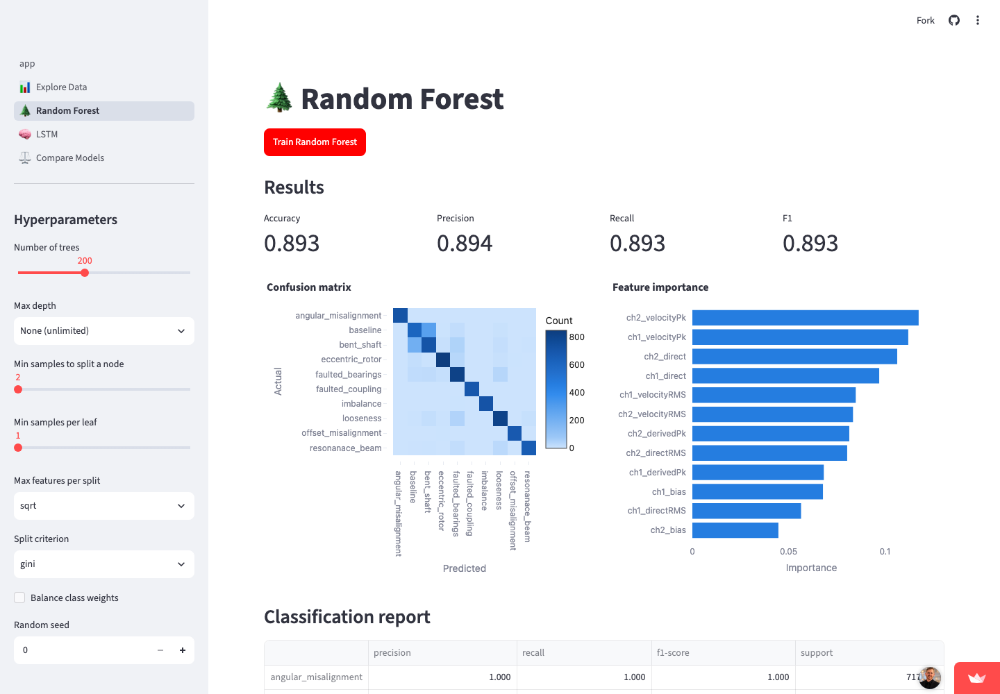

An interactive machine learning tool: upload any labeled, tabular dataset and it trains a **Random Forest** and an **LSTM** on it live, in the browser — no pre-trained models, no code required.

**What it does.**

- Automated exploratory data analysis ([ydata-profiling](https://github.com/ydataai/ydata-profiling)) on whatever is uploaded
- User picks the target and feature columns, so it works on arbitrary datasets, not just the bundled example
- Configurable Random Forest (tree count, depth, split criterion, class weighting) and LSTM (sequence length, layer count/units, dropout, optimizer, learning rate) hyperparameters, trained on demand with live progress reporting
- LSTM sequence windows are built from chronologically-sorted rows and never cross a label boundary, so the model only ever sees a real, continuous run of one condition
- Side-by-side comparison of both models' accuracy, precision, recall, and F1
- Light/dark mode, with a validated colorblind-safe palette used consistently across every chart

**Background.** This started as a vibration-sensor fault-diagnosis demo that only ran inference through two fixed, pre-trained models. I rebuilt it from the ground up to generalize the preprocessing pipeline and genuinely train both models on whatever data is uploaded.

**Stack.** Python, Streamlit, scikit-learn, TensorFlow/Keras, Plotly, ydata-profiling. Core logic has 96% unit test coverage, plus end-to-end tests of every page.

**[Live demo →](https://p75x4ucd6irncs69hakfmr.streamlit.app/)** · **[Source →](https://github.com/jwwildebeast/interactive-ml-trainer)**
