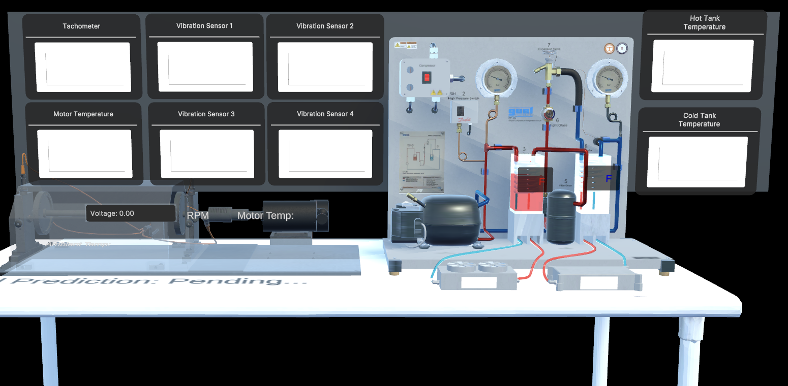

An extended-reality digital twin that monitors and diagnoses industrial motors. The motor rig sits in the context of a chiller building, showing how motor health monitoring fits into real facility equipment. Sensor data streams into a virtual environment where operators can see vibration, speed, and temperature readings, the model's fault diagnosis, and AI-generated maintenance work instructions.

**My role.** I led development of the system and built everything except the 3D modeling and some of the Unity scripting, including:

- Sensor data collection from vibration, tachometer, and temperature sensors
- Statistical analysis and feature engineering
- Machine learning fault diagnosis
- LLM-generated maintenance work instructions
- Secure remote access to the testbed over VPN

**Impact.** The University of Tennessee has copyrighted the software and is licensing it to industry partners for commercialization.

**Demonstrations.** MARCON 2026 (Knoxville, TN) and the XR Symposium at ORTECC (Oak Ridge, TN) in 2025 and 2026.

**Related publications.** This project builds on my digital twin research published in *Computers & Industrial Engineering* (2026) and presented at the Winter Simulation Conference (2024). See [Publications](/publications/).
